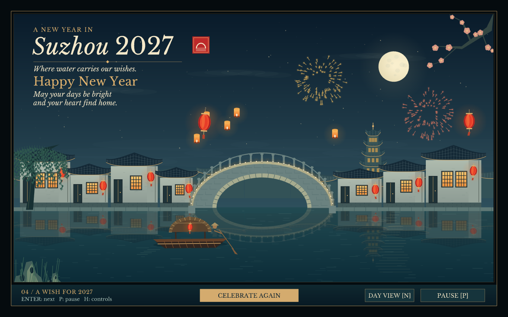
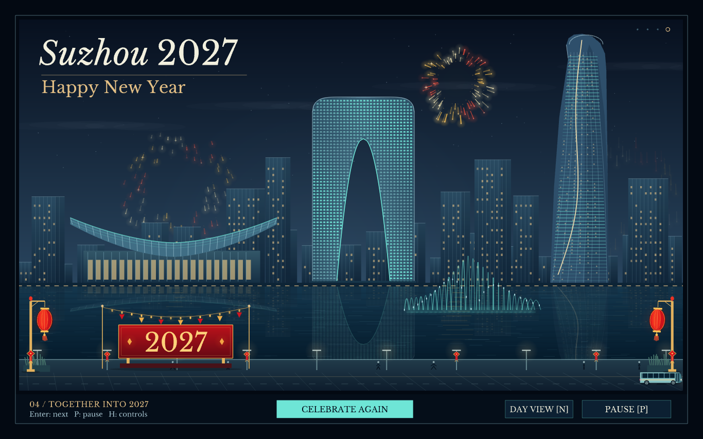

# 𝑺𝒖𝒛𝒉𝒐𝒖 2027 — 𝑰𝒏𝒕𝒆𝒓𝒂𝒄𝒕𝒊𝒗𝒆 𝑮𝒓𝒆𝒆𝒕𝒊𝒏𝒈 𝑪𝒂𝒓𝒅𝒔


𝑇𝑤𝑜 𝑖𝑛𝑡𝑒𝑟𝑎𝑐𝑡𝑖𝑣𝑒 𝑁𝑒𝑤 𝑌𝑒𝑎𝑟 𝑔𝑟𝑒𝑒𝑡𝑖𝑛𝑔 𝑐𝑎𝑟𝑑𝑠 𝑡ℎ𝑎𝑡 𝑐𝑒𝑙𝑒𝑏𝑟𝑎𝑡𝑒 𝑆𝑢𝑧ℎ𝑜𝑢 𝑡ℎ𝑟𝑜𝑢𝑔ℎ 𝑐𝑜𝑛𝑡𝑟𝑎𝑠𝑡𝑖𝑛𝑔 𝑠𝑐𝑒𝑛𝑒𝑠: 𝑡ℎ𝑒 𝑞𝑢𝑖𝑒𝑡 𝑐𝑎𝑛𝑎𝑙𝑠 𝑜𝑓 𝑎 𝐽𝑖𝑎𝑛𝑔𝑛𝑎𝑛 𝑤𝑎𝑡𝑒𝑟 𝑡𝑜𝑤𝑛 𝑎𝑛𝑑 𝑡ℎ𝑒 𝑖𝑙𝑙𝑢𝑚𝑖𝑛𝑎𝑡𝑒𝑑 𝑠𝑘𝑦𝑙𝑖𝑛𝑒 𝑜𝑓 𝐽𝑖𝑛𝑗𝑖 𝐿𝑎𝑘𝑒. 𝐵𝑢𝑖𝑙𝑡 𝑖𝑛 𝐶++ 𝑤𝑖𝑡ℎ 𝑂𝑝𝑒𝑛𝐺𝐿 𝑎𝑛𝑑 𝑓𝑟𝑒𝑒𝑔𝑙𝑢𝑡, 𝑏𝑜𝑡ℎ 𝑒𝑑𝑖𝑡𝑖𝑜𝑛𝑠 𝑐𝑜𝑚𝑏𝑖𝑛𝑒 𝑜𝑟𝑖𝑔𝑖𝑛𝑎𝑙 2𝐷 𝑎𝑟𝑡𝑤𝑜𝑟𝑘, 𝑎𝑛𝑖𝑚𝑎𝑡𝑒𝑑 𝑐𝑒𝑙𝑒𝑏𝑟𝑎𝑡𝑖𝑜𝑛𝑠, 𝑑𝑒𝑐𝑜𝑟𝑎𝑡𝑖𝑣𝑒 𝑙𝑒𝑡𝑡𝑒𝑟𝑖𝑛𝑔, 𝑎𝑛𝑑 𝑘𝑒𝑦𝑏𝑜𝑎𝑟𝑑 𝑎𝑛𝑑 𝑚𝑜𝑢𝑠𝑒 𝑖𝑛𝑡𝑒𝑟𝑎𝑐𝑡𝑖𝑜𝑛𝑠.

一座苏州，两种新年意境：江南水巷的灯火，与金鸡湖畔的现代天际线。

## 🎯 𝑂𝑣𝑒𝑟𝑣𝑖𝑒𝑤

**𝑆𝑢𝑧ℎ𝑜𝑢 2027** 𝑒𝑥𝑝𝑙𝑜𝑟𝑒𝑠 ℎ𝑜𝑤 𝑎 𝑠𝑖𝑛𝑔𝑙𝑒 𝑐𝑖𝑡𝑦 𝑐𝑎𝑛 𝑖𝑛𝑠𝑝𝑖𝑟𝑒 𝑡𝑤𝑜 𝑑𝑖𝑓𝑓𝑒𝑟𝑒𝑛𝑡 𝑣𝑖𝑠𝑢𝑎𝑙 𝑠𝑡𝑜𝑟𝑖𝑒𝑠. 𝑇ℎ𝑒 **𝑊𝑎𝑡𝑒𝑟 𝑇𝑜𝑤𝑛 𝐸𝑑𝑖𝑡𝑖𝑜𝑛** 𝑏𝑟𝑖𝑛𝑔𝑠 𝑡𝑜𝑔𝑒𝑡ℎ𝑒𝑟 𝑤ℎ𝑖𝑡𝑒𝑤𝑎𝑠ℎ𝑒𝑑 ℎ𝑜𝑢𝑠𝑒𝑠, 𝑎𝑛 𝑎𝑟𝑐ℎ𝑒𝑑 𝑏𝑟𝑖𝑑𝑔𝑒, 𝑎 𝑚𝑜𝑣𝑖𝑛𝑔 𝑐𝑎𝑛𝑎𝑙 𝑏𝑜𝑎𝑡, 𝑤𝑖𝑙𝑙𝑜𝑤 𝑏𝑟𝑎𝑛𝑐ℎ𝑒𝑠, 𝑙𝑎𝑛𝑡𝑒𝑟𝑛𝑠 𝑎𝑛𝑑 𝑓𝑙𝑜𝑎𝑡𝑖𝑛𝑔 𝑤𝑖𝑠ℎ𝑒𝑠. 𝑇ℎ𝑒 **𝑀𝑜𝑑𝑒𝑟𝑛 𝐶𝑖𝑡𝑦 𝐸𝑑𝑖𝑡𝑖𝑜𝑛** 𝑟𝑒𝑖𝑚𝑎𝑔𝑖𝑛𝑒𝑠 𝑡ℎ𝑒 𝐺𝑎𝑡𝑒 𝑜𝑓 𝑂𝑟𝑖𝑒𝑛𝑡, 𝑆𝑢𝑧ℎ𝑜𝑢 𝐼𝐹𝑆, 𝑆𝑢𝑧ℎ𝑜𝑢 𝐶𝑒𝑛𝑡𝑒𝑟 𝑎𝑛𝑑 𝐽𝑖𝑛𝑗𝑖 𝐿𝑎𝑘𝑒 𝑡ℎ𝑟𝑜𝑢𝑔ℎ 𝑔𝑙𝑎𝑠𝑠 𝑓𝑎𝑐𝑎𝑑𝑒𝑠, 𝑤𝑎𝑡𝑒𝑟𝑓𝑟𝑜𝑛𝑡 𝑚𝑜𝑣𝑒𝑚𝑒𝑛𝑡, 𝑎 𝑙𝑢𝑚𝑖𝑛𝑜𝑢𝑠 𝑓𝑜𝑢𝑛𝑡𝑎𝑖𝑛 𝑎𝑛𝑑 𝑓𝑖𝑟𝑒𝑤𝑜𝑟𝑘𝑠.

𝐸𝑎𝑐ℎ 𝑒𝑑𝑖𝑡𝑖𝑜𝑛 𝑢𝑛𝑓𝑜𝑙𝑑𝑠 𝑡ℎ𝑟𝑜𝑢𝑔ℎ **𝑓𝑜𝑢𝑟 𝑖𝑛𝑡𝑒𝑟𝑎𝑐𝑡𝑖𝑣𝑒 𝑠𝑡𝑎𝑔𝑒𝑠** 𝑎𝑛𝑑 𝑖𝑠 𝑎 𝑐𝑜𝑚𝑝𝑙𝑒𝑡𝑒, 𝑖𝑛𝑑𝑒𝑝𝑒𝑛𝑑𝑒𝑛𝑡 `.cpp` 𝑝𝑟𝑜𝑔𝑟𝑎𝑚. 𝐺𝑒𝑜𝑚𝑒𝑡𝑟𝑦, 𝑎𝑛𝑖𝑚𝑎𝑡𝑖𝑜𝑛, 𝑖𝑛𝑡𝑒𝑟𝑎𝑐𝑡𝑖𝑜𝑛 𝑎𝑛𝑑 𝑑𝑒𝑐𝑜𝑟𝑎𝑡𝑖𝑣𝑒 𝑙𝑒𝑡𝑡𝑒𝑟 𝑚𝑒𝑠ℎ𝑒𝑠 𝑎𝑟𝑒 𝑒𝑚𝑏𝑒𝑑𝑑𝑒𝑑 𝑖𝑛 𝑡ℎ𝑒 𝑠𝑜𝑢𝑟𝑐𝑒; 𝑛𝑜 𝑖𝑚𝑎𝑔𝑒𝑠 𝑜𝑟 𝑒𝑥𝑡𝑒𝑟𝑛𝑎𝑙 𝑓𝑜𝑛𝑡𝑠 𝑎𝑟𝑒 𝑙𝑜𝑎𝑑𝑒𝑑 𝑎𝑡 𝑟𝑢𝑛𝑡𝑖𝑚𝑒. 𝑇ℎ𝑒 𝑠𝑐𝑒𝑛𝑒𝑠 𝑎𝑟𝑒 𝑜𝑟𝑖𝑔𝑖𝑛𝑎𝑙 𝑖𝑙𝑙𝑢𝑠𝑡𝑟𝑎𝑡𝑖𝑜𝑛𝑠 𝑖𝑛𝑠𝑝𝑖𝑟𝑒𝑑 𝑏𝑦 𝑆𝑢𝑧ℎ𝑜𝑢, 𝑟𝑎𝑡ℎ𝑒𝑟 𝑡ℎ𝑎𝑛 𝑠𝑢𝑟𝑣𝑒𝑦𝑒𝑑 𝑝𝑎𝑛𝑜𝑟𝑎𝑚𝑎𝑠 𝑜𝑟 𝑑𝑒𝑝𝑖𝑐𝑡𝑖𝑜𝑛𝑠 𝑜𝑓 𝑎 𝑠𝑐ℎ𝑒𝑑𝑢𝑙𝑒𝑑 𝑒𝑣𝑒𝑛𝑡.

## 🖼️ 𝑃𝑟𝑒𝑣𝑖𝑒𝑤

| 𝑊𝑎𝑡𝑒𝑟 𝑇𝑜𝑤𝑛 𝐸𝑑𝑖𝑡𝑖𝑜𝑛 | 𝑀𝑜𝑑𝑒𝑟𝑛 𝐶𝑖𝑡𝑦 𝐸𝑑𝑖𝑡𝑖𝑜𝑛 |
| :---: | :---: |
|  |  |
| 白墙黛瓦 · 水巷灯影 | 东方之门 · 湖畔新光 |
| [𝑉𝑖𝑒𝑤 𝑤𝑎𝑡𝑒𝑟-𝑡𝑜𝑤𝑛 𝑠𝑜𝑢𝑟𝑐𝑒](watertown/Suzhou2027.cpp) | [𝑉𝑖𝑒𝑤 𝑚𝑜𝑑𝑒𝑟𝑛-𝑐𝑖𝑡𝑦 𝑠𝑜𝑢𝑟𝑐𝑒](modern/Suzhou2027Modern.cpp) |

𝑇ℎ𝑒𝑠𝑒 𝑠𝑐𝑟𝑒𝑒𝑛𝑠ℎ𝑜𝑡𝑠 𝑠ℎ𝑜𝑤 𝑎𝑐𝑡𝑢𝑎𝑙 𝑂𝑝𝑒𝑛𝐺𝐿 𝑜𝑢𝑡𝑝𝑢𝑡. 𝑇ℎ𝑒 𝑓𝑖𝑙𝑒𝑠 𝑖𝑛 `assets/` 𝑖𝑙𝑙𝑢𝑠𝑡𝑟𝑎𝑡𝑒 𝑡ℎ𝑖𝑠 𝑅𝐸𝐴𝐷𝑀𝐸 𝑜𝑛𝑙𝑦.

## 🛠 𝑇𝑒𝑐ℎ 𝑆𝑡𝑎𝑐𝑘

- **𝐿𝑎𝑛𝑔𝑢𝑎𝑔𝑒**: 𝐶++17
- **𝐺𝑟𝑎𝑝ℎ𝑖𝑐𝑠**: 𝑐𝑙𝑎𝑠𝑠𝑖𝑐 𝑂𝑝𝑒𝑛𝐺𝐿 𝑓𝑖𝑥𝑒𝑑-𝑓𝑢𝑛𝑐𝑡𝑖𝑜𝑛 𝑟𝑒𝑛𝑑𝑒𝑟𝑖𝑛𝑔 𝑎𝑛𝑑 𝑓𝑟𝑒𝑒𝑔𝑙𝑢𝑡
- **𝐺𝑒𝑜𝑚𝑒𝑡𝑟𝑦**: 2𝐷 𝑝𝑟𝑖𝑚𝑖𝑡𝑖𝑣𝑒𝑠, 𝑠𝑎𝑚𝑝𝑙𝑒𝑑 𝑐𝑢𝑟𝑣𝑒𝑠, 𝑝𝑜𝑙𝑦𝑔𝑜𝑛 𝑡𝑟𝑖𝑎𝑛𝑔𝑢𝑙𝑎𝑡𝑖𝑜𝑛 𝑎𝑛𝑑 𝑒𝑚𝑏𝑒𝑑𝑑𝑒𝑑 𝑙𝑒𝑡𝑡𝑒𝑟 𝑚𝑒𝑠ℎ𝑒𝑠
- **𝐴𝑛𝑖𝑚𝑎𝑡𝑖𝑜𝑛**: 𝑒𝑙𝑎𝑝𝑠𝑒𝑑-𝑡𝑖𝑚𝑒 𝑢𝑝𝑑𝑎𝑡𝑒𝑠, 𝑠𝑡𝑎𝑔𝑒 𝑡𝑟𝑎𝑛𝑠𝑖𝑡𝑖𝑜𝑛𝑠, 𝑚𝑜𝑣𝑖𝑛𝑔 𝑜𝑏𝑗𝑒𝑐𝑡𝑠 𝑎𝑛𝑑 𝑓𝑖𝑛𝑖𝑡𝑒 𝑝𝑎𝑟𝑡𝑖𝑐𝑙𝑒 𝑙𝑖𝑓𝑒𝑡𝑖𝑚𝑒𝑠
- **𝐼𝑛𝑡𝑒𝑟𝑎𝑐𝑡𝑖𝑜𝑛**: 𝑘𝑒𝑦𝑏𝑜𝑎𝑟𝑑 𝑐𝑎𝑙𝑙𝑏𝑎𝑐𝑘𝑠, 𝑚𝑜𝑢𝑠𝑒 𝑝𝑖𝑐𝑘𝑖𝑛𝑔, 𝑑𝑟𝑎𝑔𝑔𝑖𝑛𝑔, 𝑧𝑜𝑜𝑚𝑖𝑛𝑔 𝑎𝑛𝑑 𝑝𝑎𝑛𝑛𝑖𝑛𝑔
- **𝐵𝑢𝑖𝑙𝑑 𝑇𝑜𝑜𝑙𝑠**: 𝑉𝑖𝑠𝑢𝑎𝑙 𝑆𝑡𝑢𝑑𝑖𝑜 2022 𝑐𝑜𝑛𝑓𝑖𝑔𝑢𝑟𝑎𝑡𝑖𝑜𝑛 𝑖𝑛𝑠𝑡𝑟𝑢𝑐𝑡𝑖𝑜𝑛𝑠 𝑎𝑛𝑑 𝐺𝐶𝐶 𝑐𝑜𝑚𝑚𝑎𝑛𝑑𝑠 𝑏𝑒𝑙𝑜𝑤
- **𝑅𝑢𝑛𝑡𝑖𝑚𝑒 𝐴𝑠𝑠𝑒𝑡𝑠**: 𝑛𝑜 𝑖𝑚𝑎𝑔𝑒 𝑓𝑖𝑙𝑒𝑠, 𝑓𝑜𝑛𝑡 𝑓𝑖𝑙𝑒𝑠, 𝑠ℎ𝑎𝑑𝑒𝑟𝑠, 𝐺𝐿𝑈, 𝐺𝐿𝐹𝑊, 𝐺𝐿𝐸𝑊 𝑜𝑟 𝑆𝐷𝐿

## ✨ 𝐹𝑒𝑎𝑡𝑢𝑟𝑒𝑠

| 𝑆𝑡𝑎𝑔𝑒 | 𝑊𝑎𝑡𝑒𝑟 𝑇𝑜𝑤𝑛 𝐸𝑑𝑖𝑡𝑖𝑜𝑛 | 𝑀𝑜𝑑𝑒𝑟𝑛 𝐶𝑖𝑡𝑦 𝐸𝑑𝑖𝑡𝑖𝑜𝑛 |
| :--- | :--- | :--- |
| **01 · 𝐼𝑛𝑣𝑖𝑡𝑎𝑡𝑖𝑜𝑛** | 𝑂𝑝𝑒𝑛 𝑎 𝑙𝑎𝑦𝑒𝑟𝑒𝑑 𝑔𝑟𝑒𝑒𝑡𝑖𝑛𝑔 𝑐𝑎𝑟𝑑 | 𝑆𝑙𝑖𝑑𝑒 𝑜𝑝𝑒𝑛 𝑡ℎ𝑒 𝑖𝑛𝑣𝑖𝑡𝑎𝑡𝑖𝑜𝑛 𝑝𝑎𝑛𝑒𝑙𝑠 |
| **02 · 𝑀𝑜𝑣𝑒𝑚𝑒𝑛𝑡** | 𝐹𝑜𝑙𝑙𝑜𝑤 𝑎 𝑏𝑜𝑎𝑡 𝑡ℎ𝑟𝑜𝑢𝑔ℎ 𝑎 𝑑𝑎𝑦𝑡𝑖𝑚𝑒 𝑐𝑎𝑛𝑎𝑙 | 𝑊𝑎𝑡𝑐ℎ 𝑡ℎ𝑒 𝑏𝑢𝑠 𝑎𝑛𝑑 𝑤𝑎𝑙𝑘𝑒𝑟𝑠 𝑎𝑙𝑜𝑛𝑔 𝑡ℎ𝑒 𝑙𝑎𝑘𝑒 |
| **03 · 𝐿𝑖𝑔ℎ𝑡** | 𝐼𝑙𝑙𝑢𝑚𝑖𝑛𝑎𝑡𝑒 𝑙𝑎𝑛𝑡𝑒𝑟𝑛𝑠, 𝑤𝑖𝑛𝑑𝑜𝑤𝑠 𝑎𝑛𝑑 𝑡ℎ𝑒 𝑏𝑟𝑖𝑑𝑔𝑒 | 𝑅𝑒𝑙𝑖𝑔ℎ𝑡 𝑡ℎ𝑒 𝑓𝑎𝑐𝑎𝑑𝑒𝑠 𝑎𝑛𝑑 𝑠ℎ𝑎𝑝𝑒 𝑡ℎ𝑒 𝑓𝑜𝑢𝑛𝑡𝑎𝑖𝑛 |
| **04 · 𝑁𝑒𝑤 𝑌𝑒𝑎𝑟** | 𝐿𝑎𝑢𝑛𝑐ℎ 𝑓𝑖𝑟𝑒𝑤𝑜𝑟𝑘𝑠 𝑎𝑛𝑑 𝑟𝑒𝑙𝑒𝑎𝑠𝑒 𝑤𝑖𝑠ℎ 𝑙𝑎𝑛𝑡𝑒𝑟𝑛𝑠 | 𝐶𝑜𝑢𝑛𝑡 𝑑𝑜𝑤𝑛 𝑖𝑛𝑡𝑜 𝑓𝑖𝑟𝑒𝑤𝑜𝑟𝑘𝑠 𝑎𝑛𝑑 𝑝𝑎𝑖𝑛𝑡 𝑓𝑎𝑑𝑖𝑛𝑔 𝑠𝑘𝑦 𝑡𝑟𝑎𝑖𝑙𝑠 |

𝐵𝑜𝑡ℎ 𝑒𝑑𝑖𝑡𝑖𝑜𝑛𝑠 𝑖𝑛𝑐𝑙𝑢𝑑𝑒 𝑑𝑎𝑦/𝑛𝑖𝑔ℎ𝑡 𝑏𝑙𝑒𝑛𝑑𝑖𝑛𝑔, 𝑝𝑎𝑢𝑠𝑒 𝑎𝑛𝑑 𝑟𝑒𝑠𝑒𝑡 𝑐𝑜𝑛𝑡𝑟𝑜𝑙𝑠, 𝑎 𝑚𝑜𝑣𝑎𝑏𝑙𝑒 𝑐𝑎𝑚𝑒𝑟𝑎, 𝑎𝑛 𝑜𝑛-𝑠𝑐𝑟𝑒𝑒𝑛 ℎ𝑒𝑙𝑝 𝑝𝑎𝑛𝑒𝑙, 𝑓𝑢𝑙𝑙𝑠𝑐𝑟𝑒𝑒𝑛 𝑚𝑜𝑑𝑒 𝑎𝑛𝑑 𝑓𝑟𝑎𝑚𝑒𝑏𝑢𝑓𝑓𝑒𝑟 𝑐𝑎𝑝𝑡𝑢𝑟𝑒𝑠. 𝑇ℎ𝑒 𝑜𝑟𝑖𝑔𝑖𝑛𝑎𝑙 𝑑𝑒𝑐𝑜𝑟𝑎𝑡𝑖𝑣𝑒 𝑠𝑒𝑟𝑖𝑓 𝑎𝑛𝑑 𝑖𝑡𝑎𝑙𝑖𝑐 𝑙𝑒𝑡𝑡𝑒𝑟𝑖𝑛𝑔 𝑖𝑠 𝑝𝑟𝑒𝑠𝑒𝑟𝑣𝑒𝑑 𝑖𝑛 𝑏𝑜𝑡ℎ 𝑝𝑢𝑏𝑙𝑖𝑐 𝑠𝑜𝑢𝑟𝑐𝑒𝑠.

## 📁 𝑃𝑟𝑜𝑗𝑒𝑐𝑡 𝑆𝑡𝑟𝑢𝑐𝑡𝑢𝑟𝑒

```text
Suzhou-2027-OpenGL/
├── README.md
├── LICENSE
├── FONT-LICENSE.txt
├── FREEGLUT-LICENSE.txt
├── .gitignore
├── watertown/
│   └── Suzhou2027.cpp
├── modern/
│   └── Suzhou2027Modern.cpp
└── assets/
    ├── watertown.png
    └── modern.png
```

## 🚀 𝐼𝑛𝑠𝑡𝑎𝑙𝑙𝑎𝑡𝑖𝑜𝑛

### 𝑃𝑟𝑒𝑟𝑒𝑞𝑢𝑖𝑠𝑖𝑡𝑒𝑠

- 𝐴 𝐶++17 𝑐𝑜𝑚𝑝𝑖𝑙𝑒𝑟 𝑎𝑛𝑑 𝑡ℎ𝑒 𝑓𝑟𝑒𝑒𝑔𝑙𝑢𝑡 𝑑𝑒𝑣𝑒𝑙𝑜𝑝𝑚𝑒𝑛𝑡 ℎ𝑒𝑎𝑑𝑒𝑟𝑠 𝑎𝑛𝑑 𝑙𝑖𝑏𝑟𝑎𝑟𝑖𝑒𝑠.
- 𝑌𝑜𝑢𝑟 𝑝𝑙𝑎𝑡𝑓𝑜𝑟𝑚'𝑠 𝑂𝑝𝑒𝑛𝐺𝐿 𝑑𝑒𝑣𝑒𝑙𝑜𝑝𝑚𝑒𝑛𝑡 𝑙𝑖𝑏𝑟𝑎𝑟𝑖𝑒𝑠 𝑎𝑛𝑑 𝑎 𝑔𝑟𝑎𝑝ℎ𝑖𝑐𝑎𝑙 𝑑𝑒𝑠𝑘𝑡𝑜𝑝 𝑠𝑒𝑠𝑠𝑖𝑜𝑛.
- 𝐴 𝑐𝑜𝑚𝑝𝑎𝑡𝑖𝑏𝑖𝑙𝑖𝑡𝑦 𝑂𝑝𝑒𝑛𝐺𝐿 𝑐𝑜𝑛𝑡𝑒𝑥𝑡 𝑤𝑖𝑡ℎ 𝑎 𝑠𝑡𝑒𝑛𝑐𝑖𝑙 𝑏𝑢𝑓𝑓𝑒𝑟: 𝑎𝑡 𝑙𝑒𝑎𝑠𝑡 𝑡𝑤𝑜 𝑠𝑡𝑒𝑛𝑐𝑖𝑙 𝑏𝑖𝑡𝑠 𝑓𝑜𝑟 𝑡ℎ𝑒 𝑤𝑎𝑡𝑒𝑟-𝑡𝑜𝑤𝑛 𝑒𝑑𝑖𝑡𝑖𝑜𝑛 𝑎𝑛𝑑 𝑜𝑛𝑒 𝑓𝑜𝑟 𝑡ℎ𝑒 𝑚𝑜𝑑𝑒𝑟𝑛 𝑒𝑑𝑖𝑡𝑖𝑜𝑛.

**𝐵𝑢𝑖𝑙𝑑 𝑜𝑛𝑒 𝑒𝑑𝑖𝑡𝑖𝑜𝑛 𝑝𝑒𝑟 𝑒𝑥𝑒𝑐𝑢𝑡𝑎𝑏𝑙𝑒.** 𝐵𝑜𝑡ℎ 𝑠𝑜𝑢𝑟𝑐𝑒𝑠 𝑑𝑒𝑓𝑖𝑛𝑒 `main()`, 𝑠𝑜 𝑎𝑑𝑑 𝑜𝑛𝑙𝑦 𝑜𝑛𝑒 `.cpp` 𝑓𝑖𝑙𝑒 𝑡𝑜 𝑒𝑎𝑐ℎ 𝑒𝑥𝑒𝑐𝑢𝑡𝑎𝑏𝑙𝑒 𝑡𝑎𝑟𝑔𝑒𝑡. 𝑇ℎ𝑖𝑠 𝑟𝑒𝑝𝑜𝑠𝑖𝑡𝑜𝑟𝑦 𝑑𝑖𝑠𝑡𝑟𝑖𝑏𝑢𝑡𝑒𝑠 𝑠𝑜𝑢𝑟𝑐𝑒 𝑐𝑜𝑑𝑒 𝑎𝑛𝑑 𝑅𝐸𝐴𝐷𝑀𝐸 𝑖𝑚𝑎𝑔𝑒𝑠; 𝑖𝑡 𝑑𝑜𝑒𝑠 𝑛𝑜𝑡 𝑖𝑛𝑐𝑙𝑢𝑑𝑒 𝑒𝑥𝑒𝑐𝑢𝑡𝑎𝑏𝑙𝑒𝑠 𝑜𝑟 𝑎 𝑉𝑖𝑠𝑢𝑎𝑙 𝑆𝑡𝑢𝑑𝑖𝑜 𝑠𝑜𝑙𝑢𝑡𝑖𝑜𝑛.

### 𝑊𝑖𝑛𝑑𝑜𝑤𝑠 · 𝑉𝑖𝑠𝑢𝑎𝑙 𝑆𝑡𝑢𝑑𝑖𝑜 2022

1. 𝐼𝑛𝑠𝑡𝑎𝑙𝑙 𝑡ℎ𝑒 **𝐷𝑒𝑠𝑘𝑡𝑜𝑝 𝑑𝑒𝑣𝑒𝑙𝑜𝑝𝑚𝑒𝑛𝑡 𝑤𝑖𝑡ℎ 𝐶++** 𝑤𝑜𝑟𝑘𝑙𝑜𝑎𝑑 𝑎𝑛𝑑 𝑎 𝑊𝑖𝑛𝑑𝑜𝑤𝑠 𝑆𝐷𝐾. 𝐶𝑟𝑒𝑎𝑡𝑒 𝑎 𝐶++ 𝐶𝑜𝑛𝑠𝑜𝑙𝑒 𝐴𝑝𝑝 𝑜𝑟 𝑎𝑛 𝑒𝑚𝑝𝑡𝑦 𝐶++ 𝑝𝑟𝑜𝑗𝑒𝑐𝑡.
2. 𝐴𝑑𝑑 𝑒𝑖𝑡ℎ𝑒𝑟 `watertown/Suzhou2027.cpp` 𝑜𝑟 `modern/Suzhou2027Modern.cpp`. 𝑆𝑒𝑙𝑒𝑐𝑡 **𝑥64**, **𝐶++17**, 𝑎𝑛𝑑 **𝑁𝑜𝑡 𝑈𝑠𝑖𝑛𝑔 𝑃𝑟𝑒𝑐𝑜𝑚𝑝𝑖𝑙𝑒𝑑 𝐻𝑒𝑎𝑑𝑒𝑟𝑠**.
3. 𝑈𝑛𝑑𝑒𝑟 **𝐶/𝐶++ → 𝐺𝑒𝑛𝑒𝑟𝑎𝑙 → 𝐴𝑑𝑑𝑖𝑡𝑖𝑜𝑛𝑎𝑙 𝐼𝑛𝑐𝑙𝑢𝑑𝑒 𝐷𝑖𝑟𝑒𝑐𝑡𝑜𝑟𝑖𝑒𝑠**, 𝑎𝑑𝑑 𝑡ℎ𝑒 𝑓𝑟𝑒𝑒𝑔𝑙𝑢𝑡 𝑆𝐷𝐾'𝑠 `include` 𝑓𝑜𝑙𝑑𝑒𝑟 𝑐𝑜𝑛𝑡𝑎𝑖𝑛𝑖𝑛𝑔 `GL/freeglut.h`.
4. 𝑈𝑛𝑑𝑒𝑟 **𝐿𝑖𝑛𝑘𝑒𝑟 → 𝐺𝑒𝑛𝑒𝑟𝑎𝑙 → 𝐴𝑑𝑑𝑖𝑡𝑖𝑜𝑛𝑎𝑙 𝐿𝑖𝑏𝑟𝑎𝑟𝑦 𝐷𝑖𝑟𝑒𝑐𝑡𝑜𝑟𝑖𝑒𝑠**, 𝑎𝑑𝑑 𝑡ℎ𝑒 𝑆𝐷𝐾'𝑠 𝑚𝑎𝑡𝑐ℎ𝑖𝑛𝑔 𝑥64 𝑙𝑖𝑏𝑟𝑎𝑟𝑦 𝑓𝑜𝑙𝑑𝑒𝑟.
5. 𝐹𝑜𝑟 𝑎 𝑑𝑦𝑛𝑎𝑚𝑖𝑐 𝑏𝑢𝑖𝑙𝑑, 𝑎𝑑𝑑 𝑡ℎ𝑒𝑠𝑒 **𝐿𝑖𝑛𝑘𝑒𝑟 → 𝐼𝑛𝑝𝑢𝑡 → 𝐴𝑑𝑑𝑖𝑡𝑖𝑜𝑛𝑎𝑙 𝐷𝑒𝑝𝑒𝑛𝑑𝑒𝑛𝑐𝑖𝑒𝑠**:

   ```text
   freeglut.lib;opengl32.lib;gdi32.lib;winmm.lib;user32.lib
   ```

   𝑃𝑙𝑎𝑐𝑒 𝑡ℎ𝑒 𝑚𝑎𝑡𝑐ℎ𝑖𝑛𝑔 𝑥64 𝑓𝑟𝑒𝑒𝑔𝑙𝑢𝑡 𝐷𝐿𝐿 𝑏𝑒𝑠𝑖𝑑𝑒 𝑡ℎ𝑒 𝑔𝑒𝑛𝑒𝑟𝑎𝑡𝑒𝑑 𝑒𝑥𝑒𝑐𝑢𝑡𝑎𝑏𝑙𝑒. 𝐼𝑓 𝑡ℎ𝑒 𝑆𝐷𝐾 𝑝𝑟𝑜𝑣𝑖𝑑𝑒𝑠 𝑠𝑒𝑝𝑎𝑟𝑎𝑡𝑒 𝐷𝑒𝑏𝑢𝑔 𝑙𝑖𝑏𝑟𝑎𝑟𝑖𝑒𝑠 𝑎𝑛𝑑 𝐷𝐿𝐿𝑠, 𝑢𝑠𝑒 𝑡ℎ𝑒 𝑚𝑎𝑡𝑐ℎ𝑖𝑛𝑔 𝑝𝑎𝑖𝑟.
6. 𝐵𝑢𝑖𝑙𝑑 𝑤𝑖𝑡ℎ **`Ctrl+Shift+B`**, 𝑟𝑢𝑛 𝑤𝑖𝑡ℎ **`Ctrl+F5`**, 𝑓𝑜𝑐𝑢𝑠 𝑡ℎ𝑒 𝑔𝑟𝑎𝑝ℎ𝑖𝑐𝑠 𝑤𝑖𝑛𝑑𝑜𝑤 𝑎𝑛𝑑 𝑝𝑟𝑒𝑠𝑠 **`Enter`**.

𝐹𝑜𝑟 𝑎 𝑠𝑡𝑎𝑡𝑖𝑐 𝑏𝑢𝑖𝑙𝑑, 𝑑𝑒𝑓𝑖𝑛𝑒 `FREEGLUT_STATIC`, 𝑙𝑖𝑛𝑘 𝑡ℎ𝑒 𝑆𝐷𝐾'𝑠 𝑠𝑡𝑎𝑡𝑖𝑐 𝑓𝑟𝑒𝑒𝑔𝑙𝑢𝑡 𝑙𝑖𝑏𝑟𝑎𝑟𝑦 𝑖𝑛𝑠𝑡𝑒𝑎𝑑 𝑜𝑓 𝑖𝑡𝑠 𝑖𝑚𝑝𝑜𝑟𝑡 𝑙𝑖𝑏𝑟𝑎𝑟𝑦, 𝑎𝑛𝑑 𝑚𝑎𝑡𝑐ℎ 𝑖𝑡𝑠 𝑟𝑢𝑛𝑡𝑖𝑚𝑒 𝑠𝑒𝑡𝑡𝑖𝑛𝑔: `/MT`, `/MTd`, `/MD` 𝑜𝑟 `/MDd`. 𝐴𝑢𝑡𝑜𝑚𝑎𝑡𝑖𝑐 𝑙𝑖𝑏𝑟𝑎𝑟𝑦-𝑙𝑖𝑛𝑘 𝑝𝑟𝑎𝑔𝑚𝑎𝑠 𝑎𝑟𝑒 𝑑𝑖𝑠𝑎𝑏𝑙𝑒𝑑 𝑖𝑛 𝑡ℎ𝑒 𝑠𝑜𝑢𝑟𝑐𝑒𝑠, 𝑠𝑜 𝑐𝑜𝑛𝑓𝑖𝑔𝑢𝑟𝑒 𝑑𝑒𝑝𝑒𝑛𝑑𝑒𝑛𝑐𝑖𝑒𝑠 𝑒𝑥𝑝𝑙𝑖𝑐𝑖𝑡𝑙𝑦. 𝑁𝑜 `glu32.lib` 𝑖𝑠 𝑛𝑒𝑒𝑑𝑒𝑑.

𝑈𝑠𝑒 𝑀𝑆𝑉𝐶-𝑐𝑜𝑚𝑝𝑎𝑡𝑖𝑏𝑙𝑒 `.lib` 𝑓𝑖𝑙𝑒𝑠 𝑤𝑖𝑡ℎ 𝑉𝑖𝑠𝑢𝑎𝑙 𝑆𝑡𝑢𝑑𝑖𝑜; 𝑀𝑖𝑛𝐺𝑊 `.a` 𝑙𝑖𝑏𝑟𝑎𝑟𝑖𝑒𝑠 𝑎𝑟𝑒 𝑛𝑜𝑡 𝑖𝑛𝑡𝑒𝑟𝑐ℎ𝑎𝑛𝑔𝑒𝑎𝑏𝑙𝑒 𝑤𝑖𝑡ℎ 𝑡ℎ𝑒𝑚. 𝐴𝑐𝑡𝑢𝑎𝑙 𝑉𝑆 2022/𝑀𝑆𝑉𝐶 𝑐𝑜𝑚𝑝𝑖𝑙𝑎𝑡𝑖𝑜𝑛 ℎ𝑎𝑠 𝑛𝑜𝑡 𝑏𝑒𝑒𝑛 𝑣𝑒𝑟𝑖𝑓𝑖𝑒𝑑 𝑓𝑜𝑟 𝑡ℎ𝑖𝑠 𝑠𝑜𝑢𝑟𝑐𝑒 𝑟𝑒𝑙𝑒𝑎𝑠𝑒.

### 𝐿𝑖𝑛𝑢𝑥 · 𝐺𝐶𝐶

𝑊𝑖𝑡ℎ 𝑡ℎ𝑒 𝑓𝑟𝑒𝑒𝑔𝑙𝑢𝑡 𝑎𝑛𝑑 𝑂𝑝𝑒𝑛𝐺𝐿 𝑑𝑒𝑣𝑒𝑙𝑜𝑝𝑚𝑒𝑛𝑡 𝑝𝑎𝑐𝑘𝑎𝑔𝑒𝑠 𝑖𝑛𝑠𝑡𝑎𝑙𝑙𝑒𝑑, 𝑟𝑢𝑛 𝑡ℎ𝑒𝑠𝑒 𝑐𝑜𝑚𝑚𝑎𝑛𝑑𝑠 𝑓𝑟𝑜𝑚 𝑡ℎ𝑒 𝑟𝑒𝑝𝑜𝑠𝑖𝑡𝑜𝑟𝑦 𝑟𝑜𝑜𝑡:

```bash
g++ -std=c++17 -O2 -Wall -Wextra watertown/Suzhou2027.cpp -o Suzhou2027 -lglut -lGL
g++ -std=c++17 -O2 -Wall -Wextra modern/Suzhou2027Modern.cpp -o Suzhou2027Modern -lglut -lGL
```

𝐿𝑎𝑢𝑛𝑐ℎ 𝑒𝑖𝑡ℎ𝑒𝑟 𝑒𝑑𝑖𝑡𝑖𝑜𝑛:

```bash
./Suzhou2027
# or
./Suzhou2027Modern
```

𝑇ℎ𝑒𝑠𝑒 𝑎𝑟𝑒 𝑏𝑢𝑖𝑙𝑑 𝑖𝑛𝑠𝑡𝑟𝑢𝑐𝑡𝑖𝑜𝑛𝑠; 𝑎 𝐿𝑖𝑛𝑢𝑥 𝑟𝑢𝑛𝑡𝑖𝑚𝑒 𝑡𝑒𝑠𝑡 ℎ𝑎𝑠 𝑛𝑜𝑡 𝑏𝑒𝑒𝑛 𝑐𝑜𝑚𝑝𝑙𝑒𝑡𝑒𝑑.

### 𝑚𝑎𝑐𝑂𝑆 · 𝐵𝑎𝑐𝑘𝑒𝑛𝑑 𝑁𝑜𝑡𝑒𝑠

𝑇ℎ𝑒 𝑝𝑟𝑒𝑣𝑖𝑒𝑤𝑠 𝑤𝑒𝑟𝑒 𝑐𝑎𝑝𝑡𝑢𝑟𝑒𝑑 𝑢𝑠𝑖𝑛𝑔 𝑓𝑟𝑒𝑒𝑔𝑙𝑢𝑡'𝑠 𝑛𝑎𝑡𝑖𝑣𝑒 𝐶𝑜𝑐𝑜𝑎 𝑏𝑎𝑐𝑘𝑒𝑛𝑑 𝑎𝑛𝑑 𝑠𝑦𝑠𝑡𝑒𝑚 𝑂𝑝𝑒𝑛𝐺𝐿. 𝑇ℎ𝑎𝑡 𝑢𝑝𝑠𝑡𝑟𝑒𝑎𝑚 𝑏𝑎𝑐𝑘𝑒𝑛𝑑 𝑖𝑠 𝑒𝑥𝑝𝑒𝑟𝑖𝑚𝑒𝑛𝑡𝑎𝑙; 𝑡ℎ𝑖𝑠 𝑟𝑒𝑝𝑜𝑠𝑖𝑡𝑜𝑟𝑦 𝑑𝑜𝑒𝑠 𝑛𝑜𝑡 𝑏𝑢𝑛𝑑𝑙𝑒 𝑖𝑡𝑠 𝑏𝑢𝑖𝑙𝑑 𝑐𝑜𝑛𝑓𝑖𝑔𝑢𝑟𝑎𝑡𝑖𝑜𝑛 𝑜𝑟 𝑑𝑒𝑝𝑒𝑛𝑑𝑒𝑛𝑐𝑖𝑒𝑠. 𝐴 𝑓𝑟𝑒𝑒𝑔𝑙𝑢𝑡 𝑖𝑛𝑠𝑡𝑎𝑙𝑙𝑎𝑡𝑖𝑜𝑛 𝑢𝑠𝑖𝑛𝑔 𝑋11 𝑟𝑒𝑞𝑢𝑖𝑟𝑒𝑠 𝑖𝑡𝑠 𝑋 𝑠𝑒𝑟𝑣𝑒𝑟 𝑒𝑛𝑣𝑖𝑟𝑜𝑛𝑚𝑒𝑛𝑡.

𝑈𝑠𝑒 `GL/freeglut.h` 𝑎𝑛𝑑 𝑙𝑖𝑛𝑘 𝑡ℎ𝑒 𝑚𝑎𝑡𝑐ℎ𝑖𝑛𝑔 𝑓𝑟𝑒𝑒𝑔𝑙𝑢𝑡 𝑏𝑢𝑖𝑙𝑑. 𝐴𝑝𝑝𝑙𝑒'𝑠 𝑠𝑦𝑠𝑡𝑒𝑚 𝐺𝐿𝑈𝑇 𝑖𝑠 𝑎 𝑑𝑖𝑓𝑓𝑒𝑟𝑒𝑛𝑡 𝑖𝑚𝑝𝑙𝑒𝑚𝑒𝑛𝑡𝑎𝑡𝑖𝑜𝑛 𝑎𝑛𝑑 𝑑𝑜𝑒𝑠 𝑛𝑜𝑡 𝑝𝑟𝑜𝑣𝑖𝑑𝑒 𝑎𝑙𝑙 𝑡ℎ𝑒 𝑓𝑟𝑒𝑒𝑔𝑙𝑢𝑡-𝑠𝑝𝑒𝑐𝑖𝑓𝑖𝑐 𝑐𝑎𝑙𝑙𝑏𝑎𝑐𝑘𝑠 𝑢𝑠𝑒𝑑 𝑏𝑦 𝑡ℎ𝑒𝑠𝑒 𝑝𝑟𝑜𝑔𝑟𝑎𝑚𝑠.

## 🎮 𝐶𝑜𝑛𝑡𝑟𝑜𝑙𝑠

### 𝑆ℎ𝑎𝑟𝑒𝑑 𝐶𝑜𝑛𝑡𝑟𝑜𝑙𝑠

| 𝐼𝑛𝑝𝑢𝑡 | 𝐴𝑐𝑡𝑖𝑜𝑛 |
| :--- | :--- |
| `Enter` / `Space` 𝑜𝑟 𝑠𝑡𝑎𝑔𝑒 𝑏𝑢𝑡𝑡𝑜𝑛 | 𝐴𝑑𝑣𝑎𝑛𝑐𝑒 𝑡ℎ𝑟𝑜𝑢𝑔ℎ 𝑡ℎ𝑒 𝑓𝑜𝑢𝑟 𝑠𝑡𝑎𝑔𝑒𝑠 |
| `1` / `2` / `3` / `4` | 𝐽𝑢𝑚𝑝 𝑑𝑖𝑟𝑒𝑐𝑡𝑙𝑦 𝑡𝑜 𝑎 𝑠𝑡𝑎𝑔𝑒 |
| `N` 𝑜𝑟 𝐷𝑎𝑦/𝑁𝑖𝑔ℎ𝑡 𝑏𝑢𝑡𝑡𝑜𝑛 | 𝐵𝑙𝑒𝑛𝑑 𝑏𝑒𝑡𝑤𝑒𝑒𝑛 𝑑𝑎𝑦 𝑎𝑛𝑑 𝑛𝑖𝑔ℎ𝑡 |
| `P` 𝑜𝑟 𝑃𝑎𝑢𝑠𝑒 𝑏𝑢𝑡𝑡𝑜𝑛 | 𝑃𝑎𝑢𝑠𝑒 𝑜𝑟 𝑟𝑒𝑠𝑢𝑚𝑒 𝑡𝑖𝑚𝑒-𝑑𝑟𝑖𝑣𝑒𝑛 𝑎𝑛𝑖𝑚𝑎𝑡𝑖𝑜𝑛 |
| 𝑀𝑜𝑢𝑠𝑒 𝑤ℎ𝑒𝑒𝑙 𝑜𝑟 `+` / `-` | 𝑍𝑜𝑜𝑚 𝑡ℎ𝑒 𝑎𝑟𝑡𝑤𝑜𝑟𝑘 𝑤𝑖𝑡ℎ𝑖𝑛 𝑏𝑜𝑢𝑛𝑑𝑒𝑑 𝑙𝑖𝑚𝑖𝑡𝑠 |
| 𝐴𝑟𝑟𝑜𝑤 𝑘𝑒𝑦𝑠 / `0` | 𝑃𝑎𝑛 𝑡ℎ𝑒 𝑐𝑎𝑚𝑒𝑟𝑎 / 𝑟𝑒𝑠𝑡𝑜𝑟𝑒 𝑡ℎ𝑒 𝑣𝑖𝑒𝑤 |
| `H` / `R` | 𝑇𝑜𝑔𝑔𝑙𝑒 ℎ𝑒𝑙𝑝 / 𝑟𝑒𝑠𝑒𝑡 𝑡ℎ𝑒 𝑐𝑎𝑟𝑑 |
| `S` | 𝑆𝑎𝑣𝑒 𝑎 𝑃𝑃𝑀 𝑓𝑟𝑎𝑚𝑒𝑏𝑢𝑓𝑓𝑒𝑟 𝑐𝑎𝑝𝑡𝑢𝑟𝑒 𝑖𝑛 𝑡ℎ𝑒 𝑤𝑜𝑟𝑘𝑖𝑛𝑔 𝑑𝑖𝑟𝑒𝑐𝑡𝑜𝑟𝑦 |
| `F11` / `Esc` | 𝑇𝑜𝑔𝑔𝑙𝑒 𝑓𝑢𝑙𝑙𝑠𝑐𝑟𝑒𝑒𝑛 / 𝑐𝑙𝑜𝑠𝑒 ℎ𝑒𝑙𝑝 𝑜𝑟 𝑒𝑥𝑖𝑡 |

𝑇ℎ𝑒 𝑖𝑛𝑡𝑒𝑟𝑓𝑎𝑐𝑒 𝑠𝑡𝑎𝑦𝑠 𝑓𝑖𝑥𝑒𝑑 𝑤ℎ𝑖𝑙𝑒 𝑡ℎ𝑒 𝑎𝑟𝑡𝑤𝑜𝑟𝑘 𝑚𝑜𝑣𝑒𝑠. 𝑀𝑜𝑢𝑠𝑒 𝑝𝑖𝑐𝑘𝑖𝑛𝑔 𝑎𝑐𝑐𝑜𝑢𝑛𝑡𝑠 𝑓𝑜𝑟 𝑡ℎ𝑒 𝑣𝑖𝑒𝑤𝑝𝑜𝑟𝑡, 𝑧𝑜𝑜𝑚 𝑎𝑛𝑑 𝑝𝑎𝑛.

### 𝑊𝑎𝑡𝑒𝑟 𝑇𝑜𝑤𝑛 𝐸𝑑𝑖𝑡𝑖𝑜𝑛

| 𝐼𝑛𝑝𝑢𝑡 | 𝐴𝑐𝑡𝑖𝑜𝑛 |
| :--- | :--- |
| `F` 𝑜𝑟 𝑐𝑙𝑖𝑐𝑘 𝑡ℎ𝑒 𝑠𝑘𝑦 · 𝑠𝑡𝑎𝑔𝑒 4 | 𝐿𝑎𝑢𝑛𝑐ℎ 𝑎 𝑓𝑖𝑟𝑒𝑤𝑜𝑟𝑘 |
| `L` · 𝑠𝑡𝑎𝑔𝑒𝑠 3–4 | 𝑅𝑒𝑙𝑒𝑎𝑠𝑒 𝑎 𝑓𝑙𝑜𝑎𝑡𝑖𝑛𝑔 𝑤𝑖𝑠ℎ 𝑙𝑎𝑛𝑡𝑒𝑟𝑛 |
| 𝐶𝑙𝑖𝑐𝑘 𝑒𝑖𝑡ℎ𝑒𝑟 𝑙𝑎𝑟𝑔𝑒 ℎ𝑎𝑛𝑔𝑖𝑛𝑔 𝑙𝑎𝑛𝑡𝑒𝑟𝑛 · 𝑠𝑡𝑎𝑔𝑒𝑠 3–4 | 𝑇𝑜𝑔𝑔𝑙𝑒 𝑓𝑒𝑠𝑡𝑖𝑣𝑒 𝑖𝑙𝑙𝑢𝑚𝑖𝑛𝑎𝑡𝑖𝑜𝑛 |
| 𝐴𝑑𝑣𝑎𝑛𝑐𝑒 𝑎𝑔𝑎𝑖𝑛 · 𝑠𝑡𝑎𝑔𝑒 4 | 𝐴𝑑𝑑 𝑎𝑛𝑜𝑡ℎ𝑒𝑟 𝑓𝑖𝑟𝑒𝑤𝑜𝑟𝑘 𝑎𝑛𝑑 𝑤𝑖𝑠ℎ 𝑙𝑎𝑛𝑡𝑒𝑟𝑛 |

### 𝑀𝑜𝑑𝑒𝑟𝑛 𝐶𝑖𝑡𝑦 𝐸𝑑𝑖𝑡𝑖𝑜𝑛

| 𝐼𝑛𝑝𝑢𝑡 | 𝐴𝑐𝑡𝑖𝑜𝑛 |
| :--- | :--- |
| `C` / `M` · 𝑠𝑡𝑎𝑔𝑒𝑠 3–4 | 𝐶𝑦𝑐𝑙𝑒 𝑐𝑖𝑡𝑦 𝑙𝑖𝑔ℎ𝑡 𝑝𝑎𝑙𝑒𝑡𝑡𝑒𝑠 / 𝑡𝑜𝑔𝑔𝑙𝑒 𝑡ℎ𝑒 𝑓𝑜𝑢𝑛𝑡𝑎𝑖𝑛 |
| 𝐶𝑙𝑖𝑐𝑘 𝑡ℎ𝑒 𝐺𝑎𝑡𝑒 𝑜𝑓 𝑂𝑟𝑖𝑒𝑛𝑡 𝑜𝑟 𝐼𝐹𝑆 · 𝑠𝑡𝑎𝑔𝑒𝑠 3–4 | 𝑅𝑒𝑙𝑖𝑔ℎ𝑡 𝑡ℎ𝑎𝑡 𝑙𝑎𝑛𝑑𝑚𝑎𝑟𝑘 |
| 𝐶𝑙𝑖𝑐𝑘 𝑡ℎ𝑒 𝑙𝑎𝑘𝑒 · 𝑠𝑡𝑎𝑔𝑒𝑠 3–4 | 𝑆𝑒𝑡 𝑓𝑜𝑢𝑛𝑡𝑎𝑖𝑛 𝑝𝑜𝑠𝑖𝑡𝑖𝑜𝑛 𝑎𝑛𝑑 𝑗𝑒𝑡 ℎ𝑒𝑖𝑔ℎ𝑡 |
| `D` / `F` · 𝑠𝑡𝑎𝑔𝑒 4 | 𝐶𝑦𝑐𝑙𝑒 𝑓𝑖𝑟𝑒𝑤𝑜𝑟𝑘 𝑐𝑜𝑙𝑜𝑢𝑟𝑠 / 𝑙𝑎𝑢𝑛𝑐ℎ 𝑎𝑡 𝑡ℎ𝑒 𝑙𝑎𝑠𝑡 𝑠𝑘𝑦 𝑡𝑎𝑟𝑔𝑒𝑡 |
| 𝐶𝑙𝑖𝑐𝑘 / 𝑑𝑟𝑎𝑔 𝑡ℎ𝑒 𝑠𝑘𝑦 · 𝑠𝑡𝑎𝑔𝑒 4 | 𝐿𝑎𝑢𝑛𝑐ℎ 𝑎 𝑓𝑖𝑟𝑒𝑤𝑜𝑟𝑘 / 𝑝𝑎𝑖𝑛𝑡 𝑎 𝑓𝑎𝑑𝑖𝑛𝑔 𝑙𝑖𝑔ℎ𝑡 𝑡𝑟𝑎𝑖𝑙 |
| 𝐴𝑑𝑣𝑎𝑛𝑐𝑒 𝑎𝑔𝑎𝑖𝑛 · 𝑠𝑡𝑎𝑔𝑒 4 | 𝑅𝑒𝑠𝑡𝑎𝑟𝑡 𝑡ℎ𝑒 𝑡ℎ𝑟𝑒𝑒-𝑠𝑒𝑐𝑜𝑛𝑑 𝑐𝑜𝑢𝑛𝑡𝑑𝑜𝑤𝑛 𝑎𝑛𝑑 𝑓𝑖𝑟𝑒𝑤𝑜𝑟𝑘𝑠 |

𝑀𝑜𝑑𝑒𝑟𝑛-𝑐𝑖𝑡𝑦 𝑓𝑖𝑟𝑒𝑤𝑜𝑟𝑘 𝑎𝑛𝑑 𝑠𝑘𝑦-𝑡𝑟𝑎𝑖𝑙 𝑖𝑛𝑝𝑢𝑡 𝑖𝑠 𝑎𝑣𝑎𝑖𝑙𝑎𝑏𝑙𝑒 𝑤ℎ𝑖𝑙𝑒 𝑡ℎ𝑒 𝑎𝑛𝑖𝑚𝑎𝑡𝑖𝑜𝑛 𝑖𝑠 𝑢𝑛𝑝𝑎𝑢𝑠𝑒𝑑.

## 🎨 𝐺𝑟𝑎𝑝ℎ𝑖𝑐𝑠 𝑎𝑛𝑑 𝐼𝑚𝑝𝑙𝑒𝑚𝑒𝑛𝑡𝑎𝑡𝑖𝑜𝑛

| 𝑇𝑒𝑐ℎ𝑛𝑖𝑞𝑢𝑒 | 𝐴𝑝𝑝𝑙𝑖𝑐𝑎𝑡𝑖𝑜𝑛 |
| :--- | :--- |
| **2𝐷 𝑔𝑒𝑜𝑚𝑒𝑡𝑟𝑦** | 𝐴𝑟𝑐ℎ𝑖𝑡𝑒𝑐𝑡𝑢𝑟𝑒, 𝑏𝑟𝑖𝑑𝑔𝑒 𝑎𝑟𝑐ℎ𝑒𝑠, 𝑏𝑜𝑎𝑡𝑠, 𝑡𝑟𝑎𝑛𝑠𝑝𝑜𝑟𝑡, 𝑣𝑒𝑔𝑒𝑡𝑎𝑡𝑖𝑜𝑛 𝑎𝑛𝑑 𝑓𝑒𝑠𝑡𝑖𝑣𝑒 𝑑𝑒𝑐𝑜𝑟𝑎𝑡𝑖𝑜𝑛𝑠 |
| **𝑇𝑟𝑎𝑛𝑠𝑓𝑜𝑟𝑚𝑎𝑡𝑖𝑜𝑛𝑠** | 𝑅𝑒𝑝𝑒𝑎𝑡𝑒𝑑 𝑐𝑜𝑚𝑝𝑜𝑛𝑒𝑛𝑡𝑠, 𝑚𝑜𝑣𝑖𝑛𝑔 𝑜𝑏𝑗𝑒𝑐𝑡𝑠, 𝑟𝑜𝑡𝑎𝑡𝑖𝑛𝑔 𝑑𝑒𝑡𝑎𝑖𝑙𝑠 𝑎𝑛𝑑 𝑚𝑖𝑟𝑟𝑜𝑟𝑒𝑑 𝑟𝑒𝑓𝑙𝑒𝑐𝑡𝑖𝑜𝑛𝑠 |
| **𝑉𝑖𝑒𝑤𝑖𝑛𝑔 𝑎𝑛𝑑 𝑝𝑖𝑐𝑘𝑖𝑛𝑔** | 𝐴 1600 × 1000 𝑙𝑜𝑔𝑖𝑐𝑎𝑙 𝑐𝑎𝑛𝑣𝑎𝑠, 𝑎𝑠𝑝𝑒𝑐𝑡-𝑝𝑟𝑒𝑠𝑒𝑟𝑣𝑖𝑛𝑔 𝑣𝑖𝑒𝑤𝑝𝑜𝑟𝑡 𝑎𝑛𝑑 𝑖𝑛𝑣𝑒𝑟𝑠𝑒 𝑐𝑎𝑚𝑒𝑟𝑎 𝑚𝑎𝑝𝑝𝑖𝑛𝑔 |
| **𝐶𝑜𝑙𝑜𝑢𝑟 𝑎𝑛𝑑 𝑐𝑜𝑚𝑝𝑜𝑠𝑖𝑡𝑖𝑜𝑛** | 𝐼𝑛𝑡𝑒𝑟𝑝𝑜𝑙𝑎𝑡𝑒𝑑 𝑔𝑟𝑎𝑑𝑖𝑒𝑛𝑡𝑠, 𝑎𝑙𝑝ℎ𝑎-𝑏𝑙𝑒𝑛𝑑𝑒𝑑 𝑔𝑙𝑜𝑤𝑠 𝑎𝑛𝑑 𝑙𝑎𝑦𝑒𝑟𝑒𝑑 𝑠𝑐𝑒𝑛𝑒 𝑒𝑙𝑒𝑚𝑒𝑛𝑡𝑠 |
| **𝑆𝑡𝑒𝑛𝑐𝑖𝑙 𝑚𝑎𝑠𝑘𝑖𝑛𝑔** | 𝑅𝑒𝑓𝑙𝑒𝑐𝑡𝑖𝑜𝑛𝑠 𝑐𝑜𝑛𝑠𝑡𝑟𝑎𝑖𝑛𝑒𝑑 𝑡𝑜 𝑡ℎ𝑒 𝑤𝑎𝑡𝑒𝑟 𝑠𝑢𝑟𝑓𝑎𝑐𝑒 |
| **𝐴𝑛𝑖𝑚𝑎𝑡𝑖𝑜𝑛** | 𝑀𝑜𝑣𝑖𝑛𝑔 𝑡𝑟𝑎𝑛𝑠𝑝𝑜𝑟𝑡, 𝑤𝑎𝑡𝑒𝑟, 𝑙𝑎𝑛𝑡𝑒𝑟𝑛𝑠, 𝑓𝑜𝑢𝑛𝑡𝑎𝑖𝑛 𝑚𝑜𝑡𝑖𝑜𝑛 𝑎𝑛𝑑 𝑝𝑎𝑟𝑡𝑖𝑐𝑙𝑒𝑠 𝑤𝑖𝑡ℎ 𝑓𝑖𝑛𝑖𝑡𝑒 𝑙𝑖𝑓𝑒𝑡𝑖𝑚𝑒𝑠 |
| **𝑃𝑟𝑒𝑠𝑒𝑛𝑡𝑎𝑡𝑖𝑜𝑛** | 𝐷𝑜𝑢𝑏𝑙𝑒 𝑏𝑢𝑓𝑓𝑒𝑟𝑖𝑛𝑔 𝑎𝑛𝑑 𝑎𝑣𝑎𝑖𝑙𝑎𝑏𝑙𝑒 𝑚𝑢𝑙𝑡𝑖𝑠𝑎𝑚𝑝𝑙𝑖𝑛𝑔 |

𝑆𝑐𝑒𝑛𝑒 𝑠𝑡𝑎𝑡𝑒, 𝑡𝑖𝑚𝑒-𝑏𝑎𝑠𝑒𝑑 𝑢𝑝𝑑𝑎𝑡𝑒𝑠, 𝑟𝑒𝑛𝑑𝑒𝑟𝑖𝑛𝑔 𝑎𝑛𝑑 𝑖𝑛𝑝𝑢𝑡 𝑐𝑎𝑙𝑙𝑏𝑎𝑐𝑘𝑠 ℎ𝑎𝑣𝑒 𝑠𝑒𝑝𝑎𝑟𝑎𝑡𝑒 𝑟𝑜𝑙𝑒𝑠. 𝐼𝑛𝑝𝑢𝑡 𝑐ℎ𝑎𝑛𝑔𝑒𝑠 𝑡ℎ𝑒 𝑠𝑡𝑎𝑡𝑒; 𝑒𝑙𝑎𝑝𝑠𝑒𝑑-𝑡𝑖𝑚𝑒 𝑢𝑝𝑑𝑎𝑡𝑒𝑠 𝑎𝑑𝑣𝑎𝑛𝑐𝑒 𝑚𝑜𝑡𝑖𝑜𝑛; 𝑡ℎ𝑒 𝑑𝑖𝑠𝑝𝑙𝑎𝑦 𝑐𝑎𝑙𝑙𝑏𝑎𝑐𝑘 𝑑𝑟𝑎𝑤𝑠 𝑡ℎ𝑒 𝑐𝑢𝑟𝑟𝑒𝑛𝑡 𝑠𝑐𝑒𝑛𝑒 𝑎𝑛𝑑 𝑖𝑛𝑡𝑒𝑟𝑓𝑎𝑐𝑒. 𝑇ℎ𝑖𝑠 𝑘𝑒𝑒𝑝𝑠 𝑡ℎ𝑒 𝑓𝑜𝑢𝑟 𝑝𝑟𝑒𝑠𝑒𝑛𝑡𝑎𝑡𝑖𝑜𝑛 𝑠𝑡𝑎𝑔𝑒𝑠 𝑎𝑛𝑑 𝑖𝑛𝑡𝑒𝑟𝑎𝑐𝑡𝑖𝑣𝑒 𝑒𝑓𝑓𝑒𝑐𝑡𝑠 𝑐𝑜𝑜𝑟𝑑𝑖𝑛𝑎𝑡𝑒𝑑.

### 𝐸𝑚𝑏𝑒𝑑𝑑𝑒𝑑 𝐷𝑒𝑐𝑜𝑟𝑎𝑡𝑖𝑣𝑒 𝐿𝑒𝑡𝑡𝑒𝑟𝑖𝑛𝑔

𝑇ℎ𝑒 𝑐𝑎𝑟𝑑 𝑙𝑒𝑡𝑡𝑒𝑟𝑖𝑛𝑔 𝑖𝑠 𝑑𝑒𝑟𝑖𝑣𝑒𝑑 𝑓𝑟𝑜𝑚 **𝐿𝑖𝑏𝑟𝑒 𝐵𝑎𝑠𝑘𝑒𝑟𝑣𝑖𝑙𝑙𝑒 𝑅𝑒𝑔𝑢𝑙𝑎𝑟 𝑎𝑛𝑑 𝐼𝑡𝑎𝑙𝑖𝑐**. 𝐹𝑜𝑛𝑡 𝑜𝑢𝑡𝑙𝑖𝑛𝑒𝑠 𝑤𝑒𝑟𝑒 𝑐𝑜𝑛𝑣𝑒𝑟𝑡𝑒𝑑 𝑑𝑢𝑟𝑖𝑛𝑔 𝑑𝑒𝑣𝑒𝑙𝑜𝑝𝑚𝑒𝑛𝑡 𝑖𝑛𝑡𝑜 𝑡𝑟𝑖𝑎𝑛𝑔𝑙𝑒 𝑚𝑒𝑠ℎ𝑒𝑠. 𝑃𝑜𝑖𝑛𝑡 𝑎𝑟𝑟𝑎𝑦𝑠 𝑠𝑡𝑜𝑟𝑒 𝑐𝑜𝑜𝑟𝑑𝑖𝑛𝑎𝑡𝑒𝑠, 𝑖𝑛𝑑𝑒𝑥 𝑎𝑟𝑟𝑎𝑦𝑠 𝑐𝑜𝑛𝑛𝑒𝑐𝑡 𝑒𝑎𝑐ℎ 𝑔𝑟𝑜𝑢𝑝 𝑜𝑓 𝑡ℎ𝑟𝑒𝑒 𝑝𝑜𝑖𝑛𝑡𝑠 𝑖𝑛𝑡𝑜 𝑎 𝑡𝑟𝑖𝑎𝑛𝑔𝑙𝑒, 𝑎𝑛𝑑 𝑔𝑙𝑦𝑝ℎ 𝑡𝑎𝑏𝑙𝑒𝑠 𝑠𝑡𝑜𝑟𝑒 𝑠𝑝𝑎𝑐𝑖𝑛𝑔 𝑎𝑛𝑑 𝑙𝑜𝑜𝑘𝑢𝑝 𝑖𝑛𝑓𝑜𝑟𝑚𝑎𝑡𝑖𝑜𝑛.

𝑇ℎ𝑒 𝑙𝑎𝑟𝑔𝑒 𝑛𝑢𝑚𝑒𝑟𝑖𝑐 𝑎𝑟𝑟𝑎𝑦𝑠 𝑎𝑟𝑒 𝑒𝑚𝑏𝑒𝑑𝑑𝑒𝑑 𝑓𝑜𝑛𝑡 𝑟𝑒𝑠𝑜𝑢𝑟𝑐𝑒𝑠. 𝑂𝑝𝑒𝑛𝐺𝐿 𝑑𝑟𝑎𝑤𝑠 𝑡ℎ𝑒𝑚 𝑑𝑖𝑟𝑒𝑐𝑡𝑙𝑦 𝑤𝑖𝑡ℎ𝑜𝑢𝑡 𝑙𝑜𝑎𝑑𝑖𝑛𝑔 𝑓𝑜𝑛𝑡 𝑓𝑖𝑙𝑒𝑠 𝑜𝑟 𝑎𝑑𝑑𝑖𝑛𝑔 𝑎 𝑟𝑢𝑛𝑡𝑖𝑚𝑒 𝑓𝑜𝑛𝑡 𝑙𝑖𝑏𝑟𝑎𝑟𝑦. 𝑇ℎ𝑒 𝑠𝑐𝑒𝑛𝑒 𝑎𝑛𝑑 𝑖𝑛𝑡𝑒𝑟𝑎𝑐𝑡𝑖𝑜𝑛 𝑐𝑜𝑑𝑒 𝑎𝑝𝑝𝑒𝑎𝑟𝑠 𝑒𝑎𝑟𝑙𝑖𝑒𝑟 𝑖𝑛 𝑒𝑎𝑐ℎ 𝑠𝑜𝑢𝑟𝑐𝑒. 𝑇ℎ𝑒 𝑙𝑒𝑡𝑡𝑒𝑟 𝑚𝑒𝑠ℎ𝑒𝑠 𝑟𝑒𝑡𝑎𝑖𝑛 𝑡ℎ𝑒 𝑓𝑜𝑛𝑡'𝑠 𝑠𝑒𝑝𝑎𝑟𝑎𝑡𝑒 𝑙𝑖𝑐𝑒𝑛𝑐𝑒.

## 🧪 𝐶𝑎𝑝𝑡𝑢𝑟𝑒𝑠 𝑎𝑛𝑑 𝐶ℎ𝑒𝑐𝑘𝑠

𝐸𝑎𝑐ℎ 𝑝𝑟𝑜𝑔𝑟𝑎𝑚 𝑠𝑢𝑝𝑝𝑜𝑟𝑡𝑠 𝑡𝑤𝑜 𝑜𝑝𝑡𝑖𝑜𝑛𝑎𝑙 𝑐𝑜𝑚𝑚𝑎𝑛𝑑-𝑙𝑖𝑛𝑒 𝑠𝑤𝑖𝑡𝑐ℎ𝑒𝑠:

```bash
./Suzhou2027 --self-test
./Suzhou2027 --capture-all

./Suzhou2027Modern --self-test
./Suzhou2027Modern --capture-all
```

𝑂𝑛 𝑊𝑖𝑛𝑑𝑜𝑤𝑠, 𝑢𝑠𝑒 𝑡ℎ𝑒 𝑐𝑜𝑟𝑟𝑒𝑠𝑝𝑜𝑛𝑑𝑖𝑛𝑔 `.exe` 𝑛𝑎𝑚𝑒𝑠. 𝐵𝑜𝑡ℎ 𝑚𝑜𝑑𝑒𝑠 𝑜𝑝𝑒𝑛 𝑎 𝑟𝑒𝑎𝑙 𝑂𝑝𝑒𝑛𝐺𝐿 𝑤𝑖𝑛𝑑𝑜𝑤 𝑎𝑛𝑑 𝑟𝑒𝑞𝑢𝑖𝑟𝑒 𝑎 𝑔𝑟𝑎𝑝ℎ𝑖𝑐𝑎𝑙 𝑑𝑒𝑠𝑘𝑡𝑜𝑝 𝑠𝑒𝑠𝑠𝑖𝑜𝑛.

- `--self-test` 𝑟𝑢𝑛𝑠 𝑐𝑎𝑙𝑙𝑏𝑎𝑐𝑘 𝑎𝑛𝑑 𝑠𝑡𝑎𝑡𝑒 𝑐ℎ𝑒𝑐𝑘𝑠, 𝑟𝑒𝑡𝑢𝑟𝑛𝑖𝑛𝑔 𝑎 𝑛𝑜𝑛𝑧𝑒𝑟𝑜 𝑒𝑥𝑖𝑡 𝑠𝑡𝑎𝑡𝑢𝑠 𝑜𝑛 𝑓𝑎𝑖𝑙𝑢𝑟𝑒. 𝑇ℎ𝑒 𝑤𝑎𝑡𝑒𝑟-𝑡𝑜𝑤𝑛 𝑒𝑑𝑖𝑡𝑖𝑜𝑛 ℎ𝑎𝑠 **14 𝑐ℎ𝑒𝑐𝑘𝑠**; 𝑡ℎ𝑒 𝑚𝑜𝑑𝑒𝑟𝑛 𝑒𝑑𝑖𝑡𝑖𝑜𝑛 ℎ𝑎𝑠 **32 𝑐ℎ𝑒𝑐𝑘𝑠 𝑝𝑙𝑢𝑠 𝑓𝑜𝑢𝑟 𝑟𝑒𝑛𝑑𝑒𝑟𝑒𝑑-𝑠𝑡𝑎𝑔𝑒 𝑐ℎ𝑒𝑐𝑘𝑠**.
- `--capture-all` 𝑠𝑎𝑣𝑒𝑠 `stage_01.ppm` 𝑡ℎ𝑟𝑜𝑢𝑔ℎ `stage_04.ppm` 𝑖𝑛 𝑡ℎ𝑒 𝑤𝑜𝑟𝑘𝑖𝑛𝑔 𝑑𝑖𝑟𝑒𝑐𝑡𝑜𝑟𝑦, 𝑡ℎ𝑒𝑛 𝑒𝑥𝑖𝑡𝑠. 𝑅𝑢𝑛 𝑡ℎ𝑒 𝑒𝑑𝑖𝑡𝑖𝑜𝑛𝑠 𝑖𝑛 𝑠𝑒𝑝𝑎𝑟𝑎𝑡𝑒 𝑓𝑜𝑙𝑑𝑒𝑟𝑠 𝑡𝑜 𝑝𝑟𝑒𝑠𝑒𝑟𝑣𝑒 𝑏𝑜𝑡ℎ 𝑐𝑎𝑝𝑡𝑢𝑟𝑒 𝑠𝑒𝑡𝑠.
- 𝐷𝑢𝑟𝑖𝑛𝑔 𝑛𝑜𝑟𝑚𝑎𝑙 𝑢𝑠𝑒, `S` 𝑠𝑎𝑣𝑒𝑠 `Suzhou2027_capture.ppm` 𝑜𝑟 `Suzhou2027Modern_capture.ppm`. 𝑈𝑠𝑒 𝑎 𝑤𝑟𝑖𝑡𝑎𝑏𝑙𝑒 𝑤𝑜𝑟𝑘𝑖𝑛𝑔 𝑑𝑖𝑟𝑒𝑐𝑡𝑜𝑟𝑦.

𝐵𝑜𝑡ℎ 𝑝𝑢𝑏𝑙𝑖𝑐 𝑠𝑜𝑢𝑟𝑐𝑒𝑠 𝑝𝑎𝑠𝑠𝑒𝑑 𝑡ℎ𝑒𝑖𝑟 𝑛𝑎𝑡𝑖𝑣𝑒 𝑚𝑎𝑐𝑂𝑆 𝑐ℎ𝑒𝑐𝑘𝑠 𝑑𝑢𝑟𝑖𝑛𝑔 𝑟𝑒𝑙𝑒𝑎𝑠𝑒 𝑝𝑟𝑒𝑝𝑎𝑟𝑎𝑡𝑖𝑜𝑛. 𝐴𝑛 𝑒𝑎𝑟𝑙𝑖𝑒𝑟 𝑏𝑢𝑖𝑙𝑑 𝑜𝑓 𝑡ℎ𝑒 𝑚𝑜𝑑𝑒𝑟𝑛 𝑎𝑟𝑡𝑖𝑠𝑡𝑖𝑐-𝑓𝑜𝑛𝑡 𝑒𝑑𝑖𝑡𝑖𝑜𝑛 𝑟𝑎𝑛 𝑠𝑢𝑐𝑐𝑒𝑠𝑠𝑓𝑢𝑙𝑙𝑦 𝑜𝑛 𝑊𝑖𝑛𝑑𝑜𝑤𝑠 𝑥64 𝑤𝑖𝑡ℎ 𝑎𝑛 𝑁𝑉𝐼𝐷𝐼𝐴 𝑄𝑢𝑎𝑑𝑟𝑜 𝑃2000. 𝑇ℎ𝑒 𝑝𝑢𝑏𝑙𝑖𝑐 𝑤𝑎𝑡𝑒𝑟-𝑡𝑜𝑤𝑛 𝑐𝑜𝑝𝑦 𝑖𝑛𝑐𝑙𝑢𝑑𝑒𝑠 𝑡ℎ𝑒 𝑠𝑎𝑚𝑒 𝑡𝑎𝑟𝑔𝑒𝑡𝑒𝑑 𝑚𝑢𝑙𝑡𝑖𝑠𝑎𝑚𝑝𝑙𝑒-𝑞𝑢𝑒𝑟𝑦 𝑐𝑜𝑚𝑝𝑎𝑡𝑖𝑏𝑖𝑙𝑖𝑡𝑦 𝑐𝑜𝑟𝑟𝑒𝑐𝑡𝑖𝑜𝑛, 𝑏𝑢𝑡 𝑖𝑡𝑠 𝑊𝑖𝑛𝑑𝑜𝑤𝑠 𝑟𝑢𝑛𝑡𝑖𝑚𝑒 𝑟𝑒𝑚𝑎𝑖𝑛𝑠 𝑢𝑛𝑣𝑒𝑟𝑖𝑓𝑖𝑒𝑑.

## 📜 𝐿𝑖𝑐𝑒𝑛𝑐𝑒𝑠 𝑎𝑛𝑑 𝐶𝑟𝑒𝑑𝑖𝑡𝑠

| 𝑀𝑎𝑡𝑒𝑟𝑖𝑎𝑙 | 𝐿𝑖𝑐𝑒𝑛𝑐𝑒 |
| :--- | :--- |
| 𝑂𝑟𝑖𝑔𝑖𝑛𝑎𝑙 𝑐𝑜𝑑𝑒 𝑎𝑛𝑑 𝑎𝑟𝑡𝑤𝑜𝑟𝑘 𝑏𝑦 **𝐵𝑜ℎ𝑎𝑛 𝐻𝑢** | [𝑀𝐼𝑇](LICENSE) |
| 𝐷𝑒𝑟𝑖𝑣𝑒𝑑 𝐿𝑖𝑏𝑟𝑒 𝐵𝑎𝑠𝑘𝑒𝑟𝑣𝑖𝑙𝑙𝑒 𝑙𝑒𝑡𝑡𝑒𝑟 𝑚𝑒𝑠ℎ𝑒𝑠 | [𝑆𝐼𝐿 𝑂𝑝𝑒𝑛 𝐹𝑜𝑛𝑡 𝐿𝑖𝑐𝑒𝑛𝑠𝑒 1.1](FONT-LICENSE.txt) |
| 𝑓𝑟𝑒𝑒𝑔𝑙𝑢𝑡 𝑎𝑛𝑑 𝑖𝑡𝑠 𝑎𝑝𝑝𝑙𝑖𝑐𝑎𝑏𝑙𝑒 𝑛𝑜𝑡𝑖𝑐𝑒𝑠 | [𝑓𝑟𝑒𝑒𝑔𝑙𝑢𝑡 𝑙𝑖𝑐𝑒𝑛𝑐𝑒](FREEGLUT-LICENSE.txt) |

𝑇ℎ𝑒 𝑀𝐼𝑇 𝑙𝑖𝑐𝑒𝑛𝑐𝑒 𝑎𝑝𝑝𝑙𝑖𝑒𝑠 𝑡𝑜 𝑡ℎ𝑒 𝑜𝑟𝑖𝑔𝑖𝑛𝑎𝑙 𝑐𝑜𝑑𝑒 𝑎𝑛𝑑 𝑎𝑟𝑡𝑤𝑜𝑟𝑘. 𝐼𝑡 𝑑𝑜𝑒𝑠 𝑛𝑜𝑡 𝑟𝑒𝑝𝑙𝑎𝑐𝑒 𝑡ℎ𝑒 𝑠𝑒𝑝𝑎𝑟𝑎𝑡𝑒 𝑙𝑖𝑐𝑒𝑛𝑐𝑒 𝑎𝑡𝑡𝑎𝑐ℎ𝑒𝑑 𝑡𝑜 𝑡ℎ𝑒 𝑒𝑚𝑏𝑒𝑑𝑑𝑒𝑑 𝑓𝑜𝑛𝑡 𝑚𝑒𝑠ℎ𝑒𝑠. 𝑅𝑒𝑡𝑎𝑖𝑛 𝑡ℎ𝑒 𝑟𝑒𝑙𝑒𝑣𝑎𝑛𝑡 𝑛𝑜𝑡𝑖𝑐𝑒𝑠 𝑤ℎ𝑒𝑛 𝑟𝑒𝑑𝑖𝑠𝑡𝑟𝑖𝑏𝑢𝑡𝑖𝑛𝑔 𝑡ℎ𝑒 𝑝𝑟𝑜𝑗𝑒𝑐𝑡 𝑜𝑟 𝑖𝑡𝑠 𝑐𝑜𝑚𝑝𝑜𝑛𝑒𝑛𝑡𝑠.

𝐴𝑟𝑐ℎ𝑖𝑡𝑒𝑐𝑡𝑢𝑟𝑎𝑙 𝑖𝑛𝑠𝑝𝑖𝑟𝑎𝑡𝑖𝑜𝑛: [𝑃𝑖𝑛𝑔𝑗𝑖𝑎𝑛𝑔 𝑅𝑜𝑎𝑑](https://english.suzhou.gov.cn/szsenglish/szlsjq/201611/f7661df49e8e47419e09ea8dd70c2434.shtml), [𝐺𝑎𝑡𝑒 𝑡𝑜 𝑡ℎ𝑒 𝐸𝑎𝑠𝑡](https://rmjm.com/portfolio/gate-to-the-east-china/), [𝑆𝑢𝑧ℎ𝑜𝑢 𝐼𝐹𝑆](https://www.kpf.com/project/suzhou-international-finance-square), 𝑎𝑛𝑑 [𝑆𝑢𝑧ℎ𝑜𝑢 𝐶𝑒𝑛𝑡𝑟𝑒](https://www.benoy.com/projects/suzhou-centre/). 𝑅𝑒𝑓𝑒𝑟𝑒𝑛𝑐𝑒 𝑝ℎ𝑜𝑡𝑜𝑔𝑟𝑎𝑝ℎ𝑠 𝑖𝑛𝑓𝑜𝑟𝑚𝑒𝑑 𝑡ℎ𝑒 𝑖𝑙𝑙𝑢𝑠𝑡𝑟𝑎𝑡𝑖𝑜𝑛𝑠; 𝑡ℎ𝑒𝑖𝑟 𝑝𝑖𝑥𝑒𝑙𝑠 𝑎𝑟𝑒 𝑛𝑜𝑡 𝑖𝑛𝑐𝑙𝑢𝑑𝑒𝑑 𝑖𝑛 𝑡ℎ𝑒 𝑟𝑒𝑛𝑑𝑒𝑟𝑒𝑟.

*𝐼𝑓 𝑦𝑜𝑢 𝑒𝑛𝑗𝑜𝑦 𝑡ℎ𝑖𝑠 𝑝𝑟𝑜𝑗𝑒𝑐𝑡, 𝑐𝑜𝑛𝑠𝑖𝑑𝑒𝑟 𝑔𝑖𝑣𝑖𝑛𝑔 𝑖𝑡 𝑎 𝑠𝑡𝑎𝑟 ⭐ 𝑡𝑜 ℎ𝑒𝑙𝑝 𝑜𝑡ℎ𝑒𝑟𝑠 𝑑𝑖𝑠𝑐𝑜𝑣𝑒𝑟 𝑡ℎ𝑒𝑠𝑒 𝑡𝑤𝑜 𝑣𝑖𝑒𝑤𝑠 𝑜𝑓 𝑆𝑢𝑧ℎ𝑜𝑢.*
